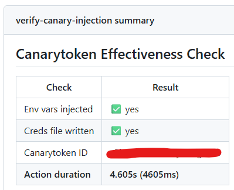

# 🐤 GitHub CI/CD Canarytoken Setup

Catch supply-chain attacks in your GitHub Workflows before they turn into breaches.

## How it works

Decoy credentials (canarytokens) are injected into a GitHub runner's environment and on disk. Compromised packages or 3rd party dependencies are a direct supply-chain risk and often ship credential stealer malware. If compromised the malware harvests and auto-validates creds using tools like [TruffleHog](https://github.com/trufflesecurity/trufflehog) - that validation attempt trips the canarytoken and alerts your SOC with high-fidelity.

> **Built for [Thinkst Canary](https://canary.tools/)** AWS canarytokens, but adaptable to any supplier with a mass-deployment API.

> ⚠️ **Alerts fire only on canarytoken validation**, not on compromise alone. This targets credential-stealer malware that auto-validates harvested creds. A worker breach by itself won't trigger an alert.

## Components

| Folder | Purpose |
|---|---|
| [`securitytoken_inject`](./securitytoken_inject/README.md) | Composite action — generates & injects canarytokens |
| [`canarytoken-test-repo`](./canarytoken-test-repo/README.md) | Test workflow — verifies the setup works |

## Setup

1. **Configure the action** in `securitytoken_inject/action.yml` (search for `# CHANGE HERE!`):
   - Set your canarytoken supplier's API domain (near the top of the file)
   - Adapt the e-mail address that should be displayed to the one of your SOC or maintainer
   - Adapt the API call logic if not using Thinkst Canary

2. **Deploy** `securitytoken_inject` to your org's shared Actions/Reusable Workflows location.

3. **Get an API key** from your provider ([Thinkst Canary guide](https://help.canary.tools/hc/en-gb/articles/7111549805213-Flock-API-Keys)), store it as the org-level secret `SECURITYTOKEN_APIKEY`, and expose it to relevant repos.

4. **Configure the test workflow** in `canarytoken-test-repo/.github/workflows/canarytoken-inject-test.yml` by pointing `uses:` at your deployed action (repo + branch).

5. **Deploy** `canarytoken-test-repo`, confirm the org secret is exposed to it.

6. **Run** the *Canarytoken Effectiveness Check* workflow and review the results.

7. **Roll out** to production repos — see [deployment examples](./securitytoken_inject/README.md#quick-usage).

## Incident response

How does your IR team respond to such an alert and attribute it to a distinct workflow run? 
During the dynamic generation of a canarytoken, the token is supplied and registered in your cloud console with data to pinpoint it's whereabouts in your GitHub environment. 
Most valuable is here the `run_url` value. It allows your IR team to step right into the exact workflow run that triggered the alert.

> **Important:** Your IR team must identify the compromised dependenc(y|ies) and rotates all secrets the worker had access to. The alert is only your detection, but not your prevention measure!

## Inspiration

[https://tracebit.com/blog/detecting-cicd-supply-chain-attacks-with-canary-credentials](https://tracebit.com/blog/detecting-cicd-supply-chain-attacks-with-canary-credentials)
[https://grafana.com/blog/canary-tokens-learn-all-about-the-unsung-heroes-of-security-at-grafana-labs/](https://grafana.com/blog/canary-tokens-learn-all-about-the-unsung-heroes-of-security-at-grafana-labs/)
